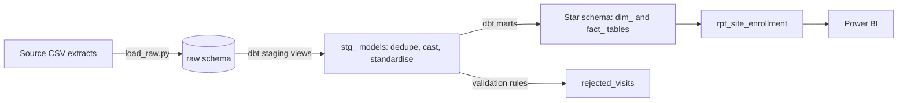
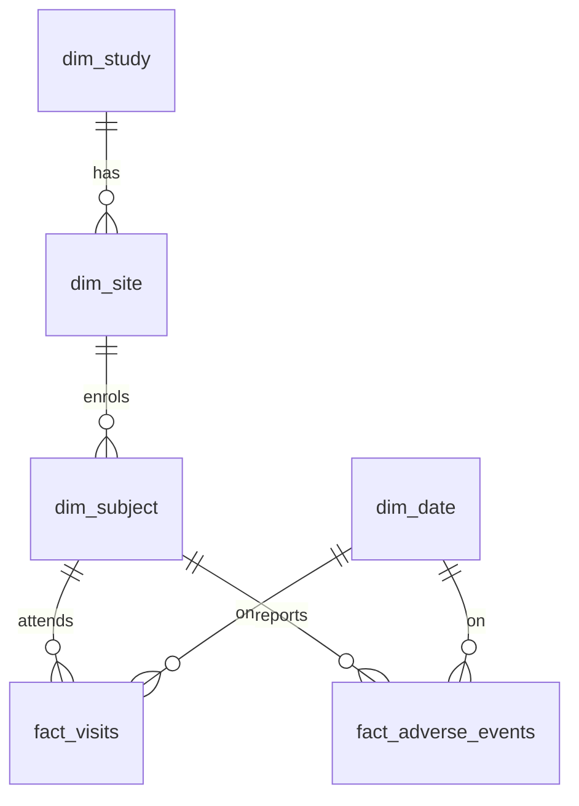

# Clinical Trial Data Warehouse


  

An ELT pipeline that loads raw clinical trial extracts into a warehouse, cleans and models them with **dbt**, and publishes a **star schema** and a reporting table ready for Power BI.

## Why this project
Clinical research teams need trustworthy site, subject and safety data. This project shows the full path from messy source files to tested, analysis-ready tables: loading, cleaning, dimensional modelling, data quality testing and CI.

## Architecture



## Star schema



| Table | Grain | Purpose |
|---|---|---|
| `dim_study` | one row per study | therapeutic area and phase |
| `dim_site` | one row per site | country and city, linked to study |
| `dim_subject` | one row per subject | age, sex, status, enrolment date, linked to site |
| `dim_date` | one row per day | year, month, quarter for time analysis |
| `fact_visits` | one row per valid visit | visit type, systolic BP, high BP flag |
| `fact_adverse_events` | one row per adverse event | term, severity, severe flag |
| `rpt_site_enrollment` | one row per site | subjects, withdrawal rate, adverse events for dashboards |
| `rejected_visits` | one row per invalid visit | rejected rows with a reason |

## Data quality
The source data is synthetic and deliberately messy. The pipeline handles:

| Problem in source | How it is handled |
|---|---|
| Exact duplicate visit and subject rows | removed in staging |
| Sex coded as M, f, Male, Female | standardised to Male, Female, Unknown |
| Blank blood pressure values | converted to NULL |
| Visit for a subject that does not exist | sent to `rejected_visits` as unknown subject |
| Visit dated before enrolment | sent to `rejected_visits` as visit before enrollment |

`dbt build` runs **41 checks**: unique, not_null, relationships, accepted_values, and two custom tests:
- no visit may occur before the subject was enrolled
- row reconciliation: staged visits = loaded visits + rejected visits, so no row is lost silently

## Project structure

```
scripts/generate_raw.py   creates synthetic source CSVs
scripts/load_raw.py       loads CSVs into the raw schema
models/staging/           cleaning views
models/marts/             dimensions, facts, report, rejected rows
tests/                    custom data tests
.github/workflows/ci.yml  runs the full pipeline on every push
```

## How to run

```
python -m venv venv
venv\Scripts\activate          # Windows
pip install -r requirements.txt

python scripts/generate_raw.py
python scripts/load_raw.py
dbt build --profiles-dir .
```

On Linux or Mac, `./run_pipeline.sh` runs the same three steps.

Expected result: `Done. PASS=41 WARN=0 ERROR=0`

## Example queries

```sql
-- sites with the highest withdrawal rate
select study_name, site_name, country, withdrawal_rate_pct
from main_marts.rpt_site_enrollment
order by withdrawal_rate_pct desc
limit 5;

-- rows rejected and why
select reject_reason, count(*) from main_marts.rejected_visits group by 1;
```

## Using it with Power BI
Export `rpt_site_enrollment` and the fact and dimension tables from `warehouse.duckdb` to CSV, or connect through the DuckDB ODBC driver, then build site enrolment, withdrawal and safety dashboards.

## Notes
- All data is synthetic. No real patient data is used.
- DuckDB stands in for a cloud warehouse such as Snowflake so the project runs locally and free. The dbt models use standard SQL.
